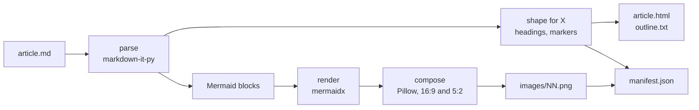
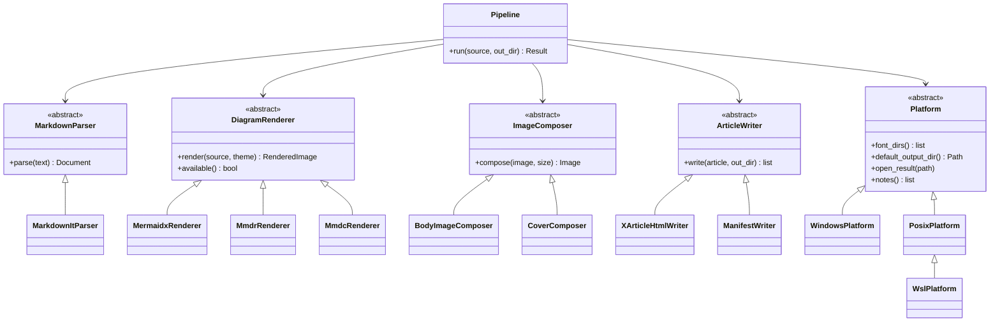
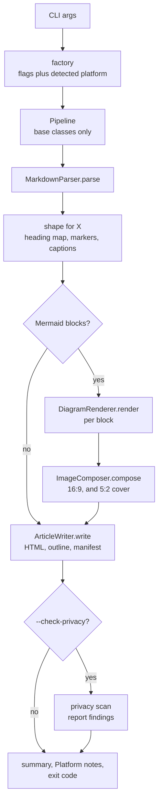
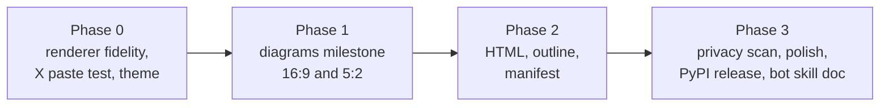

# md2xarticle

Markdown in, X Article out. One command turns a Markdown file, Mermaid diagrams included, into a paste-ready article body plus polished images for the X (Twitter) Article editor.

**Status:** design only. Nothing is implemented yet. This README is the v0 design for whoever builds it, human or bot.

### If you are an agent

Run `md2xarticle article.md -o out/ --json`.
Read `out/manifest.json`.
Paste `out/article.html` into the X Article editor, then upload each image in manifest order at its marker.

## Why

X Articles accept rich text, but only in a narrow shape: three text levels, native tables and code blocks, and images that must be uploaded in the editor because paste drops them. Long-form Markdown does not fit that shape out of the box.

Converting one real long-form article by hand showed where the time goes:

- Deep heading levels (`####` and below) had no place to go and had to be restructured by hand.
- Mermaid diagrams came out cropped tight, off-center, and in stock Mermaid styling, at whatever size the renderer picked.
- Text placeholders had to be swapped for images one by one.
- Much of the work was copy, paste, and tweak inside the X rich editor.
- The 5:2 cover image was a separate job.
- Captions taken automatically from the nearest heading read badly.
- The privacy check before publishing was a manual read-through.

md2xarticle's rule: **if the tool can do it, the human should not have to.** Whatever is left by hand (today, image uploads) is made as short and as obvious as possible.

## Just works

The intended default, once implemented:

```
pip install md2xarticle
md2xarticle article.md -o out/
```

Output:

```
out/
  article.html      # paste this into the X Article editor
  outline.txt       # the restructured heading outline, for a quick check
  manifest.json     # image order, file, caption, anchor text (for bots)
  images/
    01.png          # 16:9 body images, numbered in reading order
    02.png
    cover.png       # 5:2, only with --cover
```

Zero config is the goal. No browser, no Node, no web service, and no network at run time. The diagram font is bundled, so images look the same on every machine. Every flag has a default.

Platforms: Windows, WSL, Linux, and macOS, on Intel and ARM where the dependencies ship wheels.

**WSL note:** run inside WSL, output lands in the Linux filesystem. To paste from a browser on Windows, either write to the Windows side (`-o /mnt/c/<folder>/out`) or open the folder through `\\wsl$`. md2xarticle prints this hint when it detects WSL.

### Acceptance tests (zero-config goal)

| Input | Expected behavior |
|---|---|
| Plain Markdown, `#` and `##` only | Headings map 1:1 to Heading and Subheading; no images; `manifest.json` has an empty image list; exit 0. |
| Deep headings (`###` to `######`) | Restructured per [Headings](#headings); `outline.txt` shows the result; no heading level beyond Subheading reaches the HTML. |
| Tables and fenced code | Stay as real `<table>` and `<pre><code>` markup, never images. |
| Mermaid blocks | Each becomes a themed PNG centered on a 16:9 canvas, a numbered marker in the HTML, and a manifest entry. |
| Invalid Mermaid block | That diagram fails with its line number and the exact command to retry it alone; the rest of the article still renders; exit 1. |
| `--cover` | Adds `images/cover.png` at 5:2. |
| Front matter (YAML) | Read for title, subtitle, and cover text; not pasted into the body. |
| Empty file | Empty article, exit 0. |
| Same input twice | Byte-identical HTML and manifest; PNGs identical on the same platform. |

## Concepts



### X Article constraints

These are the facts the design is built around. Anything not listed here is unknown until the Phase 0 paste test measures it.

- **Three text levels:** Heading, Subheading, Body.
- **Tables and code blocks** are supported natively. They must reach the editor as real markup.
- **Images cannot come through paste.** They are uploaded in the editor, one at a time.
- **Cover image** is 5:2.
- **Body images** are 16:9 for now. Other ratios may come later.

### Headings

X has two heading levels, so the tool restructures instead of renaming.

| Markdown | X Article |
|---|---|
| `#` (first one, or front matter `title`) | Article title (not in the body) |
| `#` (others) or `##` | Heading |
| `###` | Subheading |
| `####` and deeper | Bold lead-in paragraph, or a list item when siblings form a list |

The exact mapping shifts by one level when a document has a single `#` used as the title. The tool picks the mapping, writes it to `outline.txt`, and prints it, so a human or bot can check the structure before pasting. `--heading-map` overrides the choice.

### Diagrams

Each Mermaid block is rendered to a PNG, trimmed, and placed on a fixed canvas.

- **Renderer:** [mermaidx](https://pypi.org/project/mermaidx/) by default. It runs real Mermaid inside an embedded QuickJS engine and rasterizes with novasvg, so it needs no Node and no Chrome. Known costs: about one second per diagram, and bundled-font metrics can differ slightly from a browser render.
- **Theme:** a clean bundled font, a soft palette, rounded boxes, and generous spacing. The exact theme is confirmed in Phase 0 after seeing real mermaidx output.
- **Composition:** Pillow trims the render, scales it to fit with even padding, and centers it on a 16:9 canvas (default 1600x900, set by `--size`). The cover composer does the same at 5:2 (default 1500x600) with optional title text.
- **Never cropped tight, never off-center.** A check measures the margins of every output image.

### Image markers and the manifest

Images cannot be pasted, so the tool makes placement obvious and ordered.

- Each diagram's spot in `article.html` holds a short visible marker, for example `[Image 02: Request flow]`, on its own line. The human or bot uploads `images/02.png` there and deletes the marker.
- `manifest.json` lists the same things in machine form:

```json
{
  "version": 1,
  "source": "article.md",
  "cover": "images/cover.png",
  "images": [
    {
      "order": 1,
      "file": "images/01.png",
      "marker": "[Image 01: System overview]",
      "caption": "System overview",
      "anchor_text": "The pieces fit together like this:",
      "source_line": 42
    }
  ]
}
```

`anchor_text` is the paragraph just before the image, so a bot can find the spot in the editor even after the marker text is gone.

### Captions

Captions come from, in order: a Mermaid `title`, a `%% caption:` comment in the block, the alt text of a following `*Figure: ...*` line, then the nearest heading. The last fallback is the one that read badly in the real conversion, so the final rules are an [open question](#open-questions).

### Privacy scan

`--check-privacy` (or the `check` command) flags, without changing anything:

- Email addresses and phone-number shapes
- Local paths: Windows user folders, Unix and macOS home folders, and `\\wsl$` shares
- Secret-shaped strings: API keys, bearer tokens, PEM blocks, credentials in URLs
- Names from an optional local deny-list file that never leaves the machine

Findings print with file and line. It is a check, not a block: exit 1 on findings, and the output files are still written.

## Architecture

The design uses abstract base classes (`abc.ABC`) as interfaces, with one concrete subclass per implementation. The interfaces sit where things really vary: the parser library, the diagram renderer, the image shape, the output format, and the operating system.



| Interface | Subclasses | What varies |
|---|---|---|
| `MarkdownParser` | `MarkdownItParser` | The parsing library, so it can be swapped later. |
| `DiagramRenderer` | `MermaidxRenderer` (default); later `MmdrRenderer` (Rust reimplementation), `MmdcRenderer` (needs Node and Chromium, opt-in only) | How Mermaid becomes pixels. |
| `ImageComposer` | `BodyImageComposer` (16:9), `CoverComposer` (5:2) | Canvas shape, padding, and cover text. |
| `ArticleWriter` | `XArticleHtmlWriter`, `ManifestWriter` | Output format. |
| `Platform` | `WindowsPlatform`, `PosixPlatform`, `WslPlatform` | Font lookup, default output folder, opening the result, the WSL paste note. |

Rules:

- **`Pipeline` depends only on the base classes.** It never imports a concrete subclass.
- **A factory picks the subclasses** from CLI flags and the detected platform. It is the only place that knows the concrete names.
- **No network renderer is ever the default.** mermaid.ink, Kroki, and similar services are out unless a future flag opts in by name.
- **Paths use `pathlib`; files are read and written as UTF-8** explicitly. The OS split lives in `Platform`, not in every class.
- **Renderers report `available()`**, so a missing optional backend fails with the install command, not a stack trace.

Pipeline:



Suggested layout:

```
src/md2xarticle/
  cli.py
  pipeline.py
  factory.py
  parse/        base.py  markdown_it.py
  shape/        headings.py  markers.py  captions.py
  render/       base.py  mermaidx.py
  compose/      base.py  body.py  cover.py
  write/        base.py  html.py  manifest.py
  platform/     base.py  windows.py  posix.py  wsl.py
  privacy.py
  assets/fonts/ (bundled font and its license)
tests/
  contracts/    one contract suite per base class
  snapshots/    synthetic .md fixtures and expected outputs
```

## Planned commands

Nothing below is implemented yet. Defaults match the [quick start](#just-works).

### `md2xarticle ARTICLE.md [-o OUT] [options]`

The full conversion: HTML, outline, images, manifest.

| Flag | Default | Meaning |
|---|---|---|
| `-o, --out DIR` | `./out` (from `Platform`) | Output folder. Created if missing. |
| `--cover` | off | Also build `images/cover.png` at 5:2. Uses front matter `title` and `subtitle` if present. |
| `--theme NAME` | `default` | Diagram theme. |
| `--size WxH` | `1600x900` | Body image size. Must be 16:9 for now. |
| `--renderer NAME` | `mermaidx` | Diagram renderer. |
| `--heading-map MAP` | auto | Override the heading restructuring. |
| `--check-privacy` | off | Run the privacy scan after writing. |
| `--json` | off | Print a machine-readable summary to stdout instead of text. |
| `--open` | off | Open the output folder when done. |

Sample output:

```
md2xarticle 0.1.0  article.md -> out/

Outline (X levels)
  H   Introduction
  H   How it works
  SH    The parser
  SH    The renderer
          [bold lead-in] Theme details
  H   Results

Images
  01  images/01.png  System overview      (after "The pieces fit together like this:")
  02  images/02.png  Request flow         (after "Each request goes through three steps:")
  cover  images/cover.png  5:2

Wrote out/article.html, out/outline.txt, out/manifest.json, 3 images in 2.4s

Next: open out/article.html, copy all, paste into the X Article editor,
then upload images in order at each [Image NN] marker.
```

`--json` output:

```json
{
  "ok": true,
  "out_dir": "out",
  "html": "out/article.html",
  "manifest": "out/manifest.json",
  "images": 2,
  "cover": true,
  "warnings": [],
  "privacy_findings": []
}
```

### `md2xarticle diagrams ARTICLE.md [-o OUT] [--cover]`

Images only: render every Mermaid block to a polished, centered 16:9 PNG, plus an optional 5:2 cover. This is the Phase 1 milestone and is useful on its own for an article whose text is already in the X editor and only needs better images.

### `md2xarticle check ARTICLE.md`

Privacy scan only. Prints findings with line numbers. Writes nothing.

### `md2xarticle outline ARTICLE.md`

Prints the restructured heading outline only, so the structure can be checked before converting.

## Output contract

Text summary to stdout by default; `--json` for machines. Warnings and errors go to stderr.

Exit codes:

| Code | Meaning |
|---|---|
| 0 | Ok. |
| 1 | Findings: a diagram failed, privacy findings, or a heading needed a forced fallback. Output that could be written was written. |
| 2 | Usage error (bad flag, missing file, wrong size ratio). |
| 3 | Internal error. |

Every error prints the exact next command to try. Examples:

```
error: diagram 03 (article.md line 88) failed to render: Parse error on line 4
try:   md2xarticle diagrams article.md --only 3 --verbose
```

```
error: renderer 'mmdc' is not installed
try:   pip install "md2xarticle[mmdc]"   (needs Node and Chromium)
or:    md2xarticle article.md --renderer mermaidx
```

## Testing

- **Contract tests.** One suite per base class. Every subclass runs its base class's suite, so a new renderer, composer, writer, or platform must pass the same checks before it plugs in.
- **Snapshot tests.** Synthetic Markdown fixtures in, expected HTML, outline, manifest, and PNG out.
- **Image checks.** Every output PNG is checked for exact size, aspect ratio, and margins (centered within a tolerance, never cropped tight).
- **Cross-platform drift.** CI runs on Windows, macOS, and Ubuntu across the supported Python versions. Each job renders the same fixtures and compares the images with a perceptual diff against the reference, so drift shows up as a failing check with the diff attached.
- **Determinism.** Same input twice gives byte-identical HTML and manifest.

## Hygiene

This is an open-source repository. Nothing personal goes in it.

- No personal information, real names, usernames, local paths, email addresses, or secrets anywhere: code, package, tests, fixtures, docs, examples, commit messages.
- Fixtures are synthetic. Real articles are tested locally and never committed.
- Example paths are generic: `article.md`, `out/`, `images/01.png`.
- A hygiene check runs in CI on every PR and push. It scans for email shapes, home-directory paths, secret shapes, and a deny-list kept outside the repo. A planted test file proves it fails visibly.
- The bundled font must have a license that allows redistribution, shipped beside it.

## Roadmap



| Phase | Work | Done when |
|---|---|---|
| 0. Measure | Render a synthetic diagram set with mermaidx on all three OSes and note fidelity gaps. Paste test: which elements survive paste into the X editor (spacing, nested lists, links, blockquotes, inline code, tables, code blocks). Show theme samples to the owner. | A short findings doc is committed: a paste-survival table, renderer notes, and the owner's theme choice. |
| 1. Diagrams | `md2xarticle diagrams article.md` produces polished, centered 16:9 PNGs and an optional 5:2 cover. ABC skeleton, contract tests, CI matrix, and hygiene check land here. | The owner drops the images into an existing X draft and approves them. CI is green on all three OSes. |
| 2. Article | HTML writer shaped by the Phase 0 paste table, heading restructuring, `outline.txt`, markers, captions, `manifest.json`, `--json`. | A synthetic long-form fixture pastes into X with no text cleanup. The owner's manual-edit list passes as acceptance tests. |
| 3. Release | Privacy scan, error messages with next commands, README and docs, a short skill doc for bots, PyPI release from CI. | `pip install md2xarticle` works on Windows, WSL, Linux, and macOS from a clean environment. |

Phase 1 comes before the full pipeline on purpose: a real article is already drafted in the X editor and is waiting only on better images.

**Project done when:** a real long-form article goes from Markdown to a ready-to-publish X draft with only the image uploads done by hand.

**Not in scope:** posting to X, driving the X editor, or any browser automation. md2xarticle writes files; a human or a bot does the upload.

## Open questions

Ask the owner. Do not guess.

- **What X paste keeps.** Spacing, nested lists, links, blockquotes, inline code, tables, and code blocks are unmeasured until the Phase 0 paste test. The HTML writer is shaped by that result, not by assumption.
- **The owner's manual edits.** The list of hand edits made in the X editor on the real article. Each one becomes an acceptance test.
- **Final diagram theme.** Font, palette, corner radius, and spacing, chosen after the owner sees real mermaidx output.
- **Image placement.** How close to one-step placement X allows. Markers plus manifest is the baseline; anything better depends on what the editor permits without browser automation.
- **Supported Python versions.** Proposed: 3.10 to 3.13, pending mermaidx wheel coverage.
- **`--watch` mode.** Wanted or not.
- **Caption source rules.** Which sources win, and whether a diagram with no explicit caption gets one at all.
- **Renderer fallback.** If mermaidx output falls short of the theme bar in Phase 0, which alternate wins: mmdr (fast, not official Mermaid) or opt-in mmdc (needs Node and Chromium).
- **Cover content.** What the 5:2 cover is built from: a chosen diagram, the title on a themed background, or a supplied image.

Proposed in this draft but not yet approved by the owner. Confirm or cut each one:

- **Subcommands `check` and `outline`,** alongside `diagrams`.
- **Flags `--heading-map`, `--only`, `--open`, and `--size`.**
- **Default image sizes:** 1600x900 for body images and 1500x600 for the cover.
- **Exit code 1** for a failed diagram or for privacy findings.
- **Caption order:** Mermaid `title`, then a `%% caption:` comment, then a following "Figure:" line, then the nearest heading.
- **Privacy deny-list:** an optional local list of names for the privacy scan, kept out of the repo.

## Working on this repo (for agents)

- **Open questions go to the owner before you guess.** If a decision is listed above, or you find a new one, ask and wait. Record the answer in this README.
- **Prefer checks over hard gates.** Report facts visibly (CI checks, findings, warnings) instead of blocking work.
- **Small, verifiable PRs.** One concern per PR, each with a done-when that a test or check confirms.
- **Do not re-run flaky tests until they pass. Fix them.** A flaky image diff usually means a nondeterministic renderer, font, or Pillow setting.
- **Keep the interfaces honest.** A new subclass passes its base class's contract suite. `Pipeline` never imports a concrete class.
- **Hygiene first.** Run the hygiene check before every push. Synthetic fixtures only.
- **No network at run time.** If a feature needs the network, it is out of scope or opt-in by name, and the owner decides.

## Prior art

Browser tools and editor extensions already convert Markdown for X Articles, and some agent skills drive the X editor through a browser. md2xarticle differs in being a local, pip-installable CLI with no browser, Node, or network, real Mermaid rendering, and a manifest so bots can finish the job.

## License

MIT, under the si4ai organization. See [LICENSE](LICENSE).
