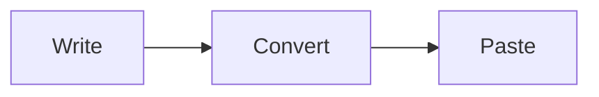

# Paste Test

This synthetic article exercises each element the HTML writer emits, so a
paste into the X Article editor shows what is kept. Every name and link in it
is made up.

## Spacing

A first paragraph. This sentence sits on a new source line but belongs to the
same paragraph.

A second paragraph after one blank line.


A third paragraph after three blank lines; it should look the same as the gap above.

A line that ends with a hard break,\
and the line after it.

## Inline styles

Plain, **bold**, *italic*, ***bold italic***, ~~struck~~, and `inline code` in one line.

Inline code with markup characters: `<div class="x">a & b</div>`.

Text with characters to escape: 3 < 4, 5 > 2, Tom & Jerry, "quotes" and 'apostrophes'.

Raw HTML in the source is shown as text: <span>not a tag</span>.

## Links

An [inline link](https://example.com/docs), a [link with a query](https://example.com/search?q=a&lang=en),
a [reference link][ref], and an autolink <https://example.org/>.

[ref]: https://example.net/reference "Reference title"

## Lists

- First bullet
- Second bullet with **bold** and a [link](https://example.com/list)
  - Nested bullet one
  - Nested bullet two
    - Third level bullet
- Third bullet
  1. Nested numbered one
  2. Nested numbered two

1. First step
2. Second step
3. Third step

A separate numbered list:

3. A numbered list that starts at three
4. And continues at four

- Loose list item one

- Loose list item two

## Quotes

> A one-paragraph quote with **bold** and a [link](https://example.com/quote).

> A quote with two paragraphs.
>
> The second paragraph of the same quote.

## Code

A fenced block with a language tag:

```python
def greet(name: str) -> str:
    if name and "<" not in name:
        return f"Hello, {name} & welcome"

    return "Hello"
```

An indented block:

    plain indented code
      keeps its indentation

## Tables

| Name | Count | Note |
|:-----|------:|:----:|
| Alpha | 1 | **bold** cell |
| Beta | 22 | `code` cell |
| Gamma | 333 | [link](https://example.com/table) |

## Images

The diagram goes here:



A Markdown image cannot be pasted either: 

## Heading levels

### A subheading

#### A deep heading that becomes a bold lead-in

Body text under the lead-in.

#### First sibling

#### Second sibling

#### Third sibling

---

The end, after a divider.
