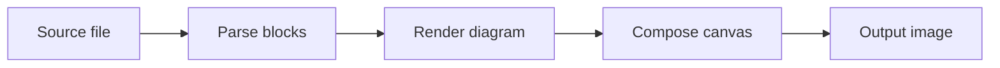
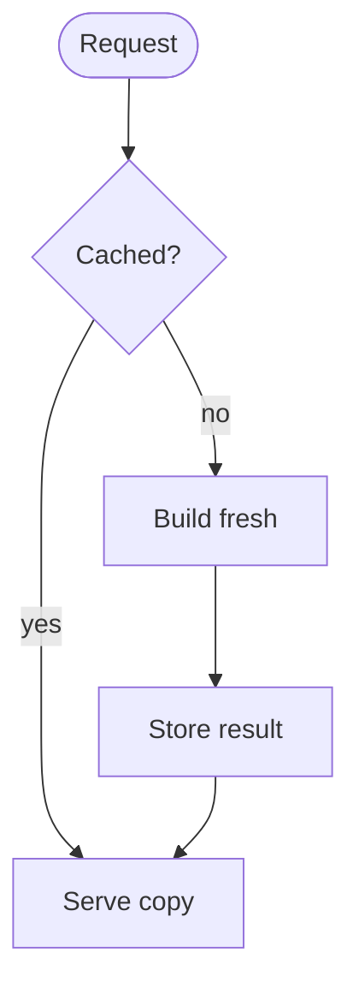
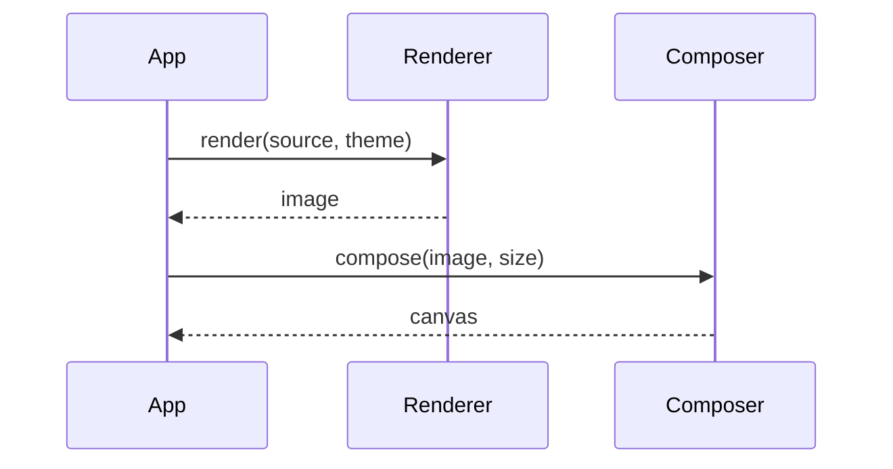
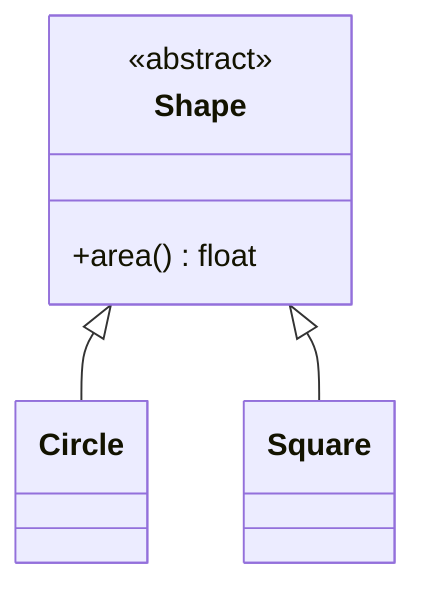

# Pipeline Sketch

A synthetic article used as a test fixture. Every name in it is made up.

## Overview

The pieces fit together like this:



## Decisions

Each request takes one of two paths:



A plain code block is not a diagram:

```python
print("not mermaid")
```

## Calls



## Types



## Broken on purpose

```mermaid
flowchart TD
    A[Start] --> B{Decision
    this line is broken on purpose
    C --> D
```

The end.
