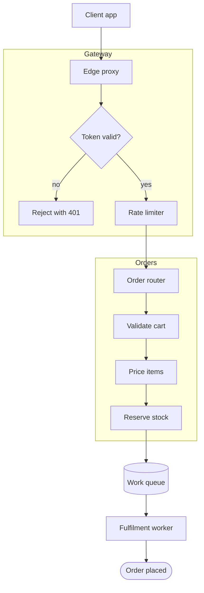
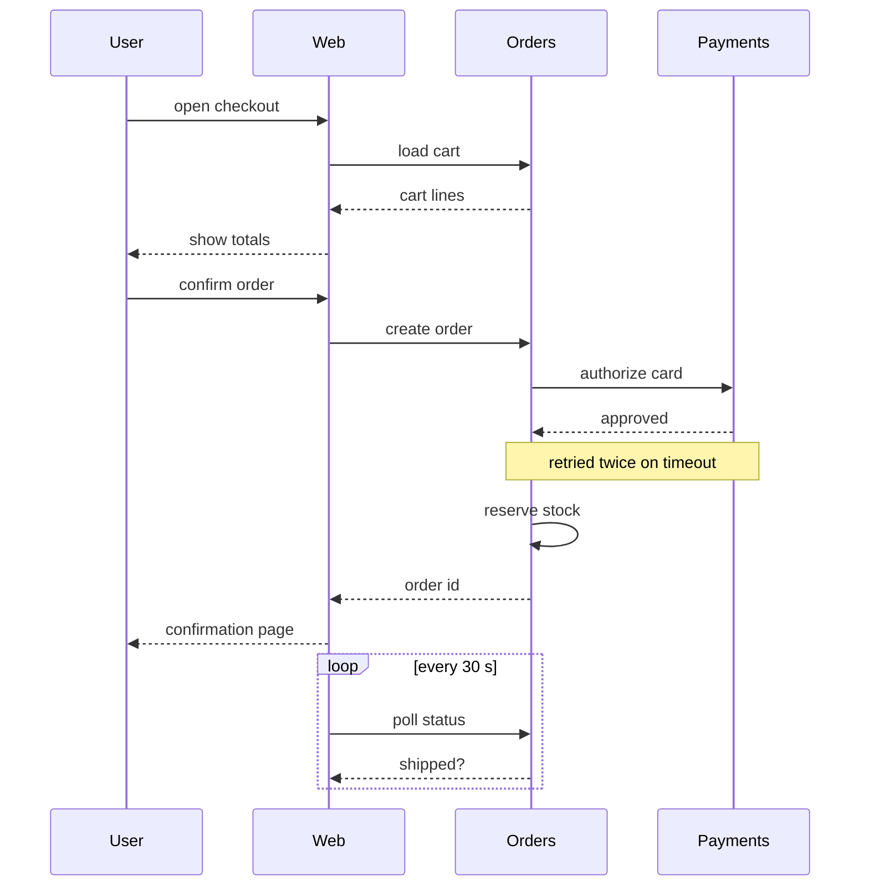
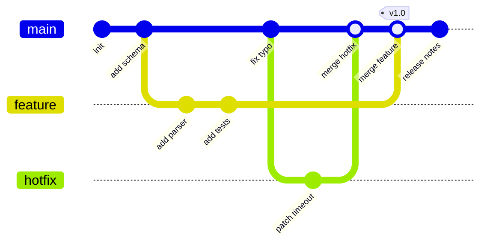
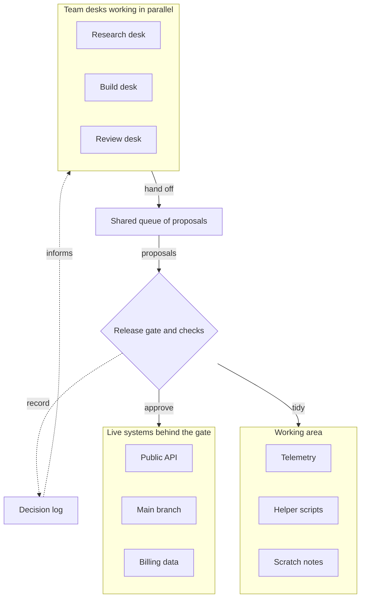

# Order Service

A synthetic fixture: tall diagrams that are limited by the height of a 16:9
canvas, and a dense gitGraph. Every name in it is made up.

## Request path

## Checkout calls

## Release history

## Team flow

A subgraph with an outgoing edge and an incoming back edge, the shape that
makes the default layout leave empty space at the bottom of the box.

